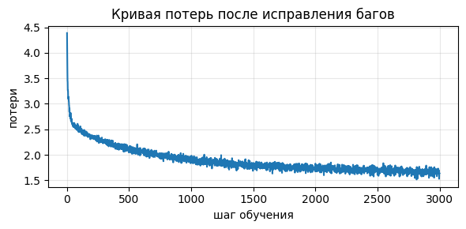

# Отчёт по заданию «Внимание своими руками»

1. В ноутбуке `Кулакова_ВВ__dz1_attention.ipynb` были дополнены 4 функции, которые реализуют механизм внимания. Итоговый прогон показал, что пройдено 17 из 17 проверок.

Самым неочевидным решением в TODO 3 оказалось порядок шагов для маски и softmax. Маску нужно подставлять после масштабирования и до softmax. 

2. В ноутбуке `Кулакова_ВВ__dz1_bughunt.ipynb` были справлены ошибки в функциях, которые реализуют механизм внимания.

Найденные ошибки:

| # | Функция и строка | Механизм поломки | Как исправили |
|---|---|---|---|
| 1 | sinusoidal_positional_encoding, 39 | Нумерация позиции начинается с 0 | 1 заменила на 0, длину столбца уменьшила на 1: (0, length) |
| 2 | LayerNorm, 60-61 | Нормализация должна быть по признакам, т.е. по последней оси | dim=-1 |
| 3 | scaled_dot_product_attention, 101 | softmax выполняется по строкам, а не столбцам | dim=-1 |

Далее была протестирована полученная модель. Взят известный текст `Tiny Shakespeare` для обучения (файл примерно на 1,1 млн символов (около 40 000 строк пьес Шекспира). В качестве параметров было выбрано 3000 шагов, и `lr = 1e-3` для ускорения сходимости. 

### Итоги обучения:

Потери уменьшились с 4.387 -> 1.640. 

Кривая потерь: 




Пример генерации для символа `b`:

```
blood should this crrown:
So hath in then me stay but the monters of solt,
Or to the blie more is and make way,
It shall now they say now to such this take in their
Them, and the make of they contencha
```

Пример генерации для символа `m`:

```
man all,
He for our myself his to but on speaks with of them?

GLOUCESTER:
Why, so your boless, he should thinks a breat
The purch other she priece the done and older
Why,---

WARWICK:
When their spore
```

Видим, что текст осмысленный, хоть и имеются орфографические ошибки. Есть знаки препинания и переносы строк, имена персонажей пишутся большими буквами. Что говорит о том, что модель усвоила паттерны данных. Что можно улучшить: добавить больше смысла в тексте, грамматику, орфографию. Для этого необходимо увеличивать контекст модели, размерность и число слоёв. 